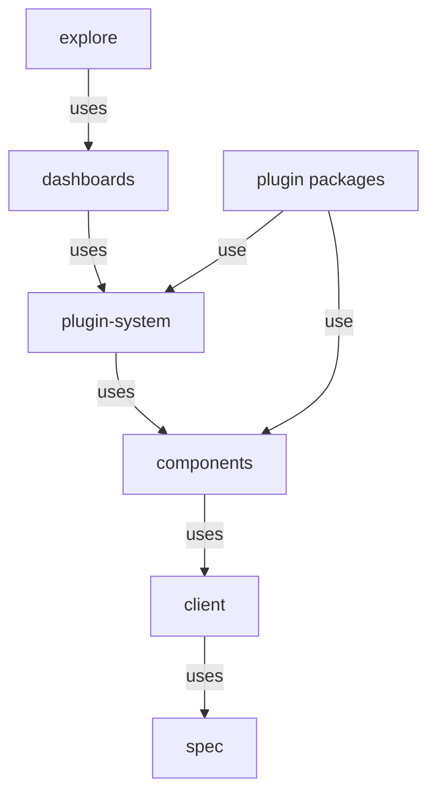

# What Is In The Perses npm Packages

The Perses web interface you open in a browser is a React application. React is a JavaScript library for building user interfaces out of components. Most of that application is not private code: it is published as npm packages under the name `@perses-dev`, so your own React application can use the same components. Before you install any of them, you need to know which package does what, because the names alone do not tell you.

## One application, many packages

Start with the example application in your playground. Its `package.json` file lists the packages it installs. A small helper saves typing: it runs a command in the app folder of the `app-builder` pod. Paste it into your terminal, then print the file:

<!-- astrona:playground:renew -->

```sh
builder() { kubectl -n embed exec -i deploy/app-builder -- sh -c "cd /workspace/app && $*"; }
builder cat package.json
```

The `dependencies` block lists nine packages whose names start with `@perses-dev/`, next to React, Material UI (`@mui/material`), TanStack Query (`@tanstack/react-query`) and ECharts (`echarts`). Every version is written exactly, with no `^` or `~` in front. The `devDependencies` block holds only the build tools: Vite, its React plugin and TypeScript.

The `@perses-dev` names fall into three groups. The Perses project describes them like this:

| Package | What it contains |
| --- | --- |
| `@perses-dev/spec` | The open specification types: dashboards, panels, variables, datasources and query results |
| `@perses-dev/client` | Types and helpers for talking to a Perses server, including the `DatasourceApi` interface |
| `@perses-dev/components` | Shared user interface components: the theme, charts setup, editors, tables |
| `@perses-dev/plugin-system` | Plugin loading, the plugin registry, and runtime state such as the time range and datasources |
| `@perses-dev/dashboards` | Dashboard providers and the `Panel` component that draws one panel |
| `@perses-dev/explore` | The Explore view for ad-hoc queries |
| `@perses-dev/prometheus-plugin`, `@perses-dev/timeseries-chart-plugin`, `@perses-dev/stat-chart-plugin` | Plugins: the Prometheus datasource and query, the time series chart, the single-value chart |

A plugin is the code for one kind of datasource, query, variable or panel. The Perses server itself shows every panel through plugins like these, so an embedded panel and a panel inside Perses run the same code.

## The layers

The packages depend on each other in one direction, from the specification types up to the dashboard components. The diagram shows the packages your app installs, with an arrow from each package to a package it depends on:



The diagram shows that `@perses-dev/dashboards` sits on top of `@perses-dev/plugin-system`, which sits on top of `@perses-dev/components`, and that everything ends at `@perses-dev/spec`.

You can see this in the installed files. npm puts every package in the folder `node_modules`, and each package has its own `package.json`. Print the dependencies that `@perses-dev/dashboards` declares:

```sh
builder "node -e \"console.log(require('./node_modules/@perses-dev/dashboards/package.json').dependencies)\""
```

The list includes `@perses-dev/components` and `@perses-dev/plugin-system` at version `0.54.0`, plus libraries such as `zustand` and `react-grid-layout` that the dashboard code uses internally. Run the same command for `@perses-dev/components`, and you find `@perses-dev/client` and `@perses-dev/spec` in its list. Each layer pulls in the layer below it.

## The deprecated package

One package from older guides does not appear in the app: `@perses-dev/core`. The Perses project marks it as deprecated, which means it still exists but must not be used in new code. Its types moved to `@perses-dev/spec` and `@perses-dev/client`.

It is still installed as a dependency of another package, though. Print the dependencies of `@perses-dev/plugin-system`:

```sh
builder "node -e \"console.log(require('./node_modules/@perses-dev/plugin-system/package.json').dependencies)\""
```

The list shows `@perses-dev/core` at version `0.53.0`, one release older than the other packages. `@perses-dev/plugin-system` still uses it internally. That is fine, because npm installs it for that package alone. If your own code imports from `@perses-dev/core` as well, you depend on a package that is on its way out, and you may end up with types that do not match the rest. The example app imports the same types from `@perses-dev/spec` and `@perses-dev/client` instead.

## Where the official guide differs

The Perses documentation has a guide for embedding a panel, and the example app follows it closely. The guide was written before some types moved, so two of its imports no longer match the 0.54.0 packages. It imports `DatasourceApi` from `@perses-dev/dashboards`, but in 0.54.0 the interface comes from `@perses-dev/client`. It imports `DurationString` and `TimeRangeValue` from `@perses-dev/core`, but the current home is `@perses-dev/spec`. Read the guide for the idea, and take the import paths from the installed packages.

You now know which package holds what, and how they stack up. The open question is how to choose their versions: the app pins nine `@perses-dev` packages, and not all of them carry the same version number.

## Common pitfalls

> [!WARNING]
> - **Installing only `@perses-dev/dashboards`.** A panel also needs the plugins that draw it and query its data. Without `@perses-dev/prometheus-plugin` and a chart plugin, nothing renders.
> - **Importing from `@perses-dev/core` in new code.** It is deprecated. Use `@perses-dev/spec` for specification types and `@perses-dev/client` for API types.
> - **Copying import paths from an older guide.** Types move between releases. Check where a name is exported in the installed package.
> - **Reading the package name as the version.** `@perses-dev/prometheus-plugin` has its own version line, separate from `@perses-dev/dashboards`.
