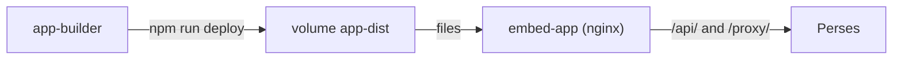

# Building The App In The Cluster

Choosing the right versions is half the work; the other half is turning the source into files a browser can load. In this course that happens inside the cluster, so your machine needs no Node.js. This part follows the example app from source to a page you can open, and shows how to rebuild it after a change.

## From source to page

Three pieces in the namespace `embed` do the work, and each has one job. The `app-builder` pod holds the source in `/workspace/app` and runs Node.js. The volume `app-dist` is shared storage: the builder writes the built files to it, at `/srv/dist`. The `embed-app` pod runs nginx, a web server that serves those files and forwards two paths to the Perses server.



The diagram shows the builder writing to the volume, nginx reading from it, and nginx forwarding API and proxy requests to Perses.

The source starts in a ConfigMap called `app-source`. When the builder pod starts, a small init container copies it into `/workspace/app`, because a ConfigMap is read-only and cannot hold folders. That folder is an `emptyDir` volume, so it lives only as long as the pod: if the builder restarts, your edits and the installed packages are gone, and you copy and install again.

## Install, build, deploy

The app's `package.json` defines the commands. `npm install` downloads the packages into `node_modules`. `npm run build` runs `vite build`: Vite is a build tool that bundles the TypeScript source and every package it imports into a few JavaScript files in `dist/`. `npm run deploy` copies `dist/` to `/srv/dist`. Define the helper and run all three; the playground has installed the packages once already, so `npm install` finishes quickly:

<!-- astrona:playground:renew -->

```sh
builder() { kubectl -n embed exec -i deploy/app-builder -- sh -c "cd /workspace/app && $*"; }
builder npm install --no-audit --no-fund
builder npm run build
builder npm run deploy
```

`npm run build` prints the files Vite wrote: an `index.html` and one large JavaScript file under `dist/assets/`, several megabytes in size, because it contains React, Material UI, ECharts and the Perses packages. Vite may warn that a chunk is large; for this app that is expected.

## Look at the result

nginx now serves the new files. Start a port-forward to it in a second terminal and leave it running:

```sh
kubectl -n embed port-forward svc/embed-app 8081:8081
```

Open `http://app.localtest.me:8081` in your browser. The page shows one panel, "Prometheus target up", with a line at the value 1: the Prometheus server is up. The data in that panel took a long path. The panel code in your browser asked the app's own origin for `/proxy/globaldatasources/prometheus/...`; nginx forwarded the request to Perses; and Perses forwarded it to Prometheus. That path is why the browser never needs to reach Prometheus directly.

nginx decides what goes where. Read its configuration from the ConfigMap:

```sh
kubectl -n embed get configmap embed-app-nginx -o jsonpath='{.data.default\.conf}'
```

There are three `location` blocks. `/` serves files from the volume, and falls back to `index.html` for any path it does not find. `/api/` and `/proxy/` go to `http://perses.perses.svc.cluster.local:8080`. Remember the fallback: if a JavaScript file is missing, nginx answers with `index.html` instead of an error, and the browser then fails to run HTML as a script.

## Change and rebuild

Every change follows the same loop: change the source, build, deploy, reload. Rename the panel to see it work. The `sed` command edits the file in place inside the builder:

```sh
builder "sed -i 's/Prometheus target up/Prometheus targets/' src/App.tsx"
builder "npm run build && npm run deploy"
```

Reload the browser page, and the panel title reads "Prometheus targets". The packages did not change, so `npm install` was not needed; you only run it again when `package.json` changes.

You can now build the app from its source, serve it, and rebuild it after a change. What is still open is what happens when `package.json` holds versions that do not fit together, which is the situation the lab starts from.

## Common pitfalls

> [!WARNING]
> - **Forgetting `npm run deploy`.** `npm run build` writes to `dist/` inside the builder only; nginx keeps serving the old files.
> - **Expecting edits to survive a builder restart.** `/workspace/app` is an `emptyDir`. A new pod starts from the ConfigMap again.
> - **Changing `package.json` without `npm install`.** The build then uses the packages installed before the change.
> - **Reading a blank page as a data problem.** A blank page is usually a script that did not load. Check that its `/assets/` path returns JavaScript, not HTML.

## Your mission: Align The Perses Package Versions

You can now install, build and serve the app, and read an npm peer dependency error. The graded lab gives you an app whose `package.json` mixes three releases, so `npm install` fails, and asks you to pin versions that fit Perses v0.54.0 and serve a working build.

The lab runs in its own cluster, so first pause your playground. Nothing in it is lost:

```sh
astrona stop ats-110-playground-010-01
```

Then start the lab:

```sh
astrona run --git ssh://git@github.com/astrona-io/ATS110.git -c sections/section-010/module-01/labs/lab-01
```

The task is on the next page. Solve it on your own first. When you think you are done, send it for grading:

```sh
astrona submit -c sections/section-010/module-01/labs/lab-01
```

When the lab is done, remove it and start your playground again:

```sh
astrona destroy ats-110-lab-010-01
astrona start ats-110-playground-010-01
```
