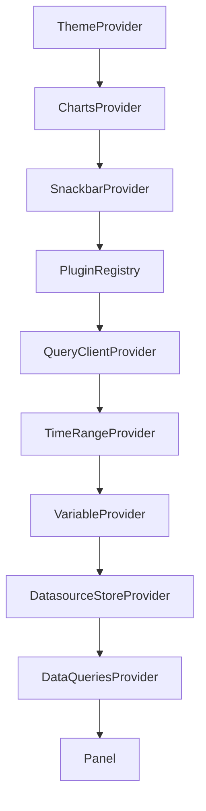

# The Providers A Panel Needs

Open the app in the playground and you see one chart. Open its source and you see that the chart is a single `<Panel>` element wrapped in ten other components. Those wrappers are not decoration: take one away and the panel stops working, often with an error that does not name what is missing. This part goes through them, so you know what each one supplies and where it must sit.

## Look at the app

Print the app's main component. A small helper runs commands in the app folder of the builder pod:

<!-- astrona:playground:renew -->

```sh
builder() { kubectl -n embed exec -i deploy/app-builder -- sh -c "cd /workspace/app && $*"; }
builder cat src/App.tsx
```

The file has three parts. At the top it imports from five `@perses-dev` packages and from Material UI and TanStack Query. In the middle it builds three objects once: a datasource API, a plugin loader that knows the Prometheus plugin and the time series chart plugin, and a query client. At the bottom, the `App` component returns the nested providers with the `<Panel>` at the centre.

A **provider** is a React component that makes a value available to every component inside it. A component deep inside can read that value without receiving it as a property from each parent. The panel and the plugins inside it read several such values, so each one must come from a provider above them.

## The providers, outside in

Each provider has one job. The table follows the order in the file, from the outermost:

| Provider | Package | What it supplies |
| --- | --- | --- |
| `ThemeProvider` | `@mui/material` | The Material UI theme; Perses builds it with `getTheme('light')` |
| `ChartsProvider` | `@perses-dev/components` | The ECharts theme, made from the Material UI theme with `generateChartsTheme` |
| `SnackbarProvider` | `@perses-dev/components` | The small pop-up messages for errors and successes |
| `PluginRegistry` | `@perses-dev/plugin-system` | The plugins that can be used, from a plugin loader, and the default plugin kinds |
| `QueryClientProvider` | `@tanstack/react-query` | The cache and request runner every query goes through |
| `TimeRangeProvider` | `@perses-dev/plugin-system` | The time range and the refresh interval, with functions to change them |
| `VariableProvider` | `@perses-dev/dashboards` | Dashboard variables that queries can use as `${name}`; empty here |
| `DatasourceStoreProvider` | `@perses-dev/dashboards` | The datasources, through the `DatasourceApi` you pass it |
| `DataQueriesProvider` | `@perses-dev/plugin-system` | The queries for the panel inside it, and their results |

The order follows what each provider needs. `ChartsProvider` reads the Material UI theme, so it sits inside `ThemeProvider`. `DatasourceStoreProvider` looks up datasource plugins, so it sits inside `PluginRegistry`. `DataQueriesProvider` runs queries with the time range and the datasources, so it sits inside both `TimeRangeProvider` and `DatasourceStoreProvider`.



The diagram shows the nesting from the outermost provider down to the panel.

## How a panel gets drawn

Follow one panel from the definition to the chart. `DataQueriesProvider` receives a list of query definitions; here one, of kind `PrometheusTimeSeriesQuery`, with the PromQL text `up{job="prometheus"}`. It asks `PluginRegistry` for the plugin of that kind, which is in `@perses-dev/prometheus-plugin`. The query plugin asks `DatasourceStoreProvider` for a Prometheus datasource, and runs the query through it with the current time range. The results go back down to `<Panel>`, which asks `PluginRegistry` for the panel plugin named in its definition, `TimeSeriesChart`, and lets it draw.

`PluginRegistry` only knows the plugins its loader lists. The app's loader lists two, each with the module description from `getPluginModule()` and a function that returns the plugin code:

```sh
builder "grep -n -A4 'dynamicImportPluginLoader(\[' src/App.tsx"
```

The loader holds one entry for `prometheusPlugin` and one for `timeseriesChartPlugin`. A panel of kind `StatChart` would fail here with an error that the plugin cannot be found, until `@perses-dev/stat-chart-plugin` is installed, imported and added to this list.

## Where this app gets its data

The weak point of the guide's app is its datasource. Print the top of the file again and look at `fakeDatasource`:

```sh
builder "grep -n -B2 -A10 'const fakeDatasource' src/App.tsx"
```

The datasource has a `directUrl` of `https://prometheus.demo.do.prometheus.io`, the public Prometheus demo server. `directUrl` means the browser sends each query straight to that address. Whether the panel shows data then depends on your browser reaching the internet address and that server allowing cross-origin requests. It also ignores every datasource configured in your Perses server. The class `FakeDatasourceApi` returns this one object for every lookup.

You now know what each provider supplies, why they nest the way they do, and how a query travels to the panel. The open question is the datasource: how to make the panel use the `prometheus` datasource that Perses already has, without the browser ever reaching Prometheus.

## Common pitfalls

> [!WARNING]
> - **Moving `DataQueriesProvider` outside `DatasourceStoreProvider`.** The query plugin then finds no datasource store, and the panel shows an error instead of data.
> - **Forgetting a plugin in the loader.** Installing `@perses-dev/stat-chart-plugin` is not enough; it must also be listed in `dynamicImportPluginLoader`.
> - **Creating the `QueryClient` inside the component.** It is rebuilt on every render and loses its cache. Create it once, outside the component.
> - **Trusting `directUrl` in a browser app.** The browser then needs network access to the datasource and the datasource must allow cross-origin requests.
