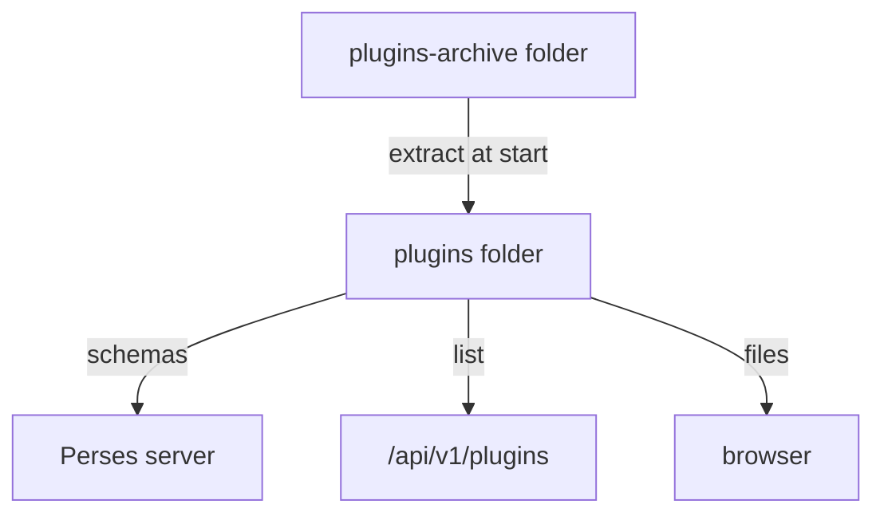

# Plugin Modules And Archives

Before writing a plugin, it helps to see how Perses runs the ones it already has. Every chart, every query type and every datasource type in Perses is a plugin, loaded the same way a plugin you write will be. This part looks at the plugins in a running server, and at the archive format and the folders Perses loads them from.

## Plugin types

Perses has five kinds of plugin, and each does one job:

| Type | What it does | Example |
| --- | --- | --- |
| Datasource | Connects to a data backend | `PrometheusDatasource` |
| Query | Fetches data through a datasource, for one data type (time series, traces, logs, profiles) | `PrometheusTimeSeriesQuery` |
| Panel | Draws query results | `TimeSeriesChart` |
| Variable | Provides values for a dashboard variable | `PrometheusLabelValuesVariable` |
| Explore | Provides a view in the Explore page | the Prometheus explorer |

Datasource, query and variable plugins always need a schema; panel plugins usually have one too. A **plugin module** is one npm package that holds one or more plugins. The Prometheus module, for example, holds a datasource plugin, a query plugin, variable plugins and an explore plugin.

## The plugins in a running server

The Perses server lists its loaded modules at `/api/v1/plugins`. Ask it from the `tester` pod, and print each module with the plugins it holds:

<!-- astrona:playground:renew -->

```sh
kubectl -n observability exec deploy/tester -- sh -c \
  'curl -s http://perses.perses.svc.cluster.local:8080/api/v1/plugins | jq -r ".[] | \"\(.metadata.name) \(.metadata.version): \([.spec.plugins[].spec.name] | join(\", \"))\""'
```

Each line is one module: its name, its version, and its plugins. `TimeSeriesChart 0.13.0` holds one plugin. The `Prometheus` module holds several, among them `PrometheusDatasource` and `PrometheusTimeSeriesQuery`. None of these were installed separately: they ship inside the Perses release.

## The two halves of a plugin

A plugin has a backend half and a frontend half, and two different components use them. The Perses **server** uses the backend half, a CUE schema, to check a plugin's settings whenever a dashboard is saved. CUE is a configuration language that can describe which fields and values are allowed. The **browser** uses the frontend half, React code built with `rsbuild`, to draw the panel.

The browser loads that code at run time with **module federation**: a way for a web page to load JavaScript modules from a separate build while it runs. The Perses page knows only the module list; for each plugin it needs, it fetches the module's manifest, then the JavaScript files. The server serves them under `/plugins/<module name>/`. Fetch the manifest of the time series chart module:

```sh
kubectl -n observability exec deploy/tester -- \
  curl -s http://perses.perses.svc.cluster.local:8080/plugins/TimeSeriesChart/mf-manifest.json | head -c 400
```

The start of a JSON document comes back, with the module name `TimeSeriesChart` and a list of exposed modules and their JavaScript files. This is the file the browser reads first when a dashboard uses a `TimeSeriesChart` panel.

## The archive

A plugin module is shipped as one archive: `.tar.gz`, `.tar` or `.zip`. Its layout is fixed:

| Path in the archive | What it holds |
| --- | --- |
| `package.json` | The module name, version, and the `perses` block listing its plugins |
| `mf-manifest.json`, `mf-stats.json` | The module federation manifest the browser reads |
| `__mf/` | The JavaScript, CSS and fonts the browser loads |
| `lib/` | The same code as an npm package, for embedding in other apps |
| `schemas/` | The CUE schema of each plugin, with a JSON example, and an optional Grafana migration file |
| `cue.mod/` | The CUE module definition and any CUE dependencies |

You do not write this archive by hand. `percli plugin build` assembles it from a plugin module's folder.

## How Perses loads archives

Loading happens at start. Perses reads every archive in the folder set by `plugin.archive_path`, extracts each one into the folder set by `plugin.path`, loads every schema into memory, and writes the list it serves at `/api/v1/plugins`. In the container image, the archive folder is `/etc/perses/plugins-archive`, and the bundled plugins are already in it.



The diagram shows archives extracted at start, with the schemas going to the server and the list and files going to the browser.

Two facts follow. A new archive is only seen after Perses restarts. And whatever adds your archive must not replace the archive folder, or the bundled plugins disappear with it.

You now know what Perses loads, from where, and when. The open question is how to produce such an archive for a plugin of your own.

## Common pitfalls

> [!WARNING]
> - **Expecting a new archive to load without a restart.** Perses reads the archive folder only at start.
> - **Mounting a volume over the whole archive folder.** The bundled plugins vanish, and every dashboard with a time series chart breaks.
> - **Confusing the module name with the plugin name.** `/api/v1/plugins` lists modules; each module lists its plugins.
> - **Thinking the schema runs in the browser.** The server enforces it when a dashboard is saved.
